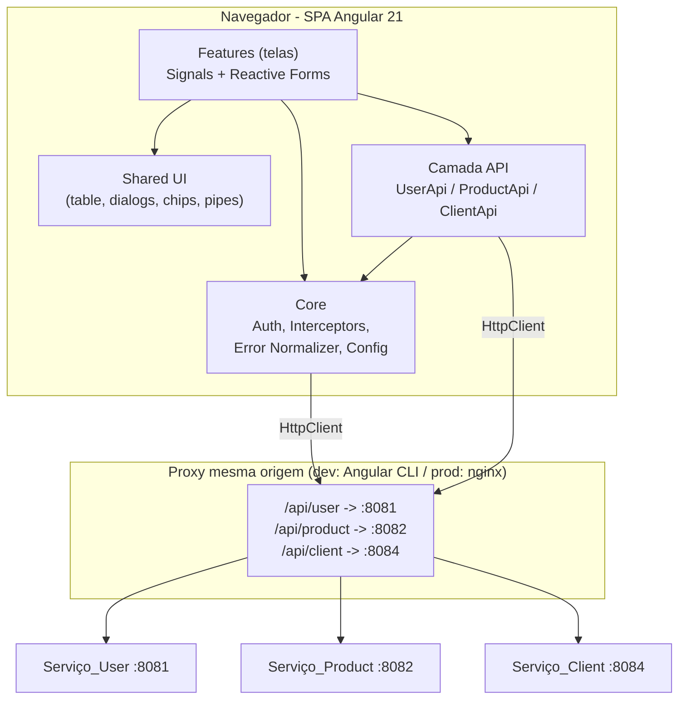
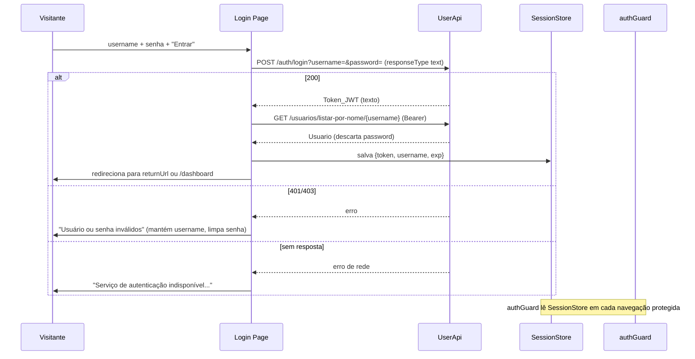

# Design Document

## Overview

Este documento descreve o design do **Painel Super Admin** do Easy Eats: uma SPA Angular, interna, que a equipe Easy Eats usa para administrar Clientes (estabelecimentos), Categorias, Produtos/Planos e Usuários do painel. O Painel consome quatro microsserviços Spring Boot mantidos por times diferentes (Serviço_User, Serviço_Product, Serviço_Client e Serviço_Base, este último fora de escopo) e nunca fala diretamente com eles pelo navegador: todo tráfego passa por um proxy de mesma origem (proxy do Angular em desenvolvimento, nginx em produção), o que elimina a dependência de CORS e de um gateway ainda inexistente.

O design cobre os 20 requisitos de `requirements.md` e respeita o Anexo A como contrato de dados. As decisões aprovadas pelo usuário já estão incorporadas: convenção de portas (User 8081, Product 8082, Base 8083, Client 8084, gateway 8080 reservado); mensagens próprias por status para o Serviço_Product; reativação apenas via campo `status` de Categoria e Produto; e os valores numéricos (debounce 300 ms, tamanhos de página 10/20/50/100 com padrão 20, snackbar de sucesso por 4 s, cobertura mínima de 80% em serviços e utilitários).

### Versão do stack

A máquina de desenvolvimento tem **Node v22.21.0**, **npm 10.9.4** e **Angular CLI 21.0.3** global. A versão mais nova do Angular (22.3.0) exige Node `^22.22.3 || ^24.15.0 || >=26.0.0` — incompatível com a 22.21.0 instalada ([engines do @angular/core 22](https://www.npmjs.com/package/@angular/core)). Portanto o Painel usa **Angular 21.2.x (LTS)**, cujo requisito é Node `^20.19.0 || ^22.12.0 || >=24.0.0`, atendido pela máquina. Decorrências dessa escolha:

- **Angular 21**: standalone components (sem NgModules), signals, novo control flow (`@if`/`@for`/`@switch`), `inject()`, rotas lazy por feature, functional guards e functional interceptors.
- **Angular Material 21** (Material 3), tema configurável com `theme-type: color-scheme` (gera `light-dark()` nativo do CSS), alternância clara/escura por classe no `<html>`.
- **Vitest** como runner de testes padrão do Angular 21 (`ng test`), substituindo Karma/Jasmine ([Angular testing overview](https://angular.dev/guide/testing)).
- **TypeScript** na faixa `>=5.9 <6.0` (peer do `@angular/build` 21), modo `strict`.
- **fast-check 4.x** para testes baseados em propriedades ([fast-check](https://www.npmjs.com/package/fast-check)).
- **angular-eslint** para lint.

Conteúdo das fontes acima foi reescrito para conformidade com restrições de licenciamento.

### Objetivos de design

1. **Isolamento de backends**: uma fachada HTTP por serviço, com modelos TS espelhando o Anexo A; telas nunca montam URLs nem conhecem detalhes de transporte.
2. **Erros uniformes**: um Normalizador_De_Erros converte ProblemDetail (Client), Erro_Padrão_Spring (Product) e texto puro (User) em uma estrutura única.
3. **Mesma origem**: prefixos `/api/user`, `/api/product`, `/api/client` reescritos por proxy em dev e prod.
4. **Acessibilidade e responsividade** como requisitos de primeira classe (WCAG 2.1 AA, 360–1920 px).
5. **Testabilidade**: lógica pura (CNPJ, BRL, normalizador) isolada em utilitários e verificada por property-based testing.

## Architecture

### Visão em camadas



### Estrutura de pastas

```
superadmin-frontend/
  src/
    app/
      core/
        auth/            session.store.ts, auth.service.ts, auth.guard.ts, login-redirect.ts
        http/            auth.interceptor.ts, error.interceptor.ts, service-base-url.ts
        errors/          error-normalizer.ts, normalized-error.model.ts
        config/          app-config.ts, environment tokens
        notifications/   notification.service.ts
      shared/
        ui/              page-header, data-table, empty-state, skeleton-rows,
                         confirm-dialog, status-chip, form-field-error
        pipes/           cnpj.pipe.ts, phone.pipe.ts, brl.pipe.ts, status-label.pipe.ts
        validators/      cnpj.validator.ts, phone.validator.ts, match.validator.ts
        util/            cnpj.ts, money.ts, query-params.ts
        forms/           unsaved-changes.guard.ts
      features/
        auth/            login (page + store)
        dashboard/       dashboard page + store
        clients/         list, form, detail + client.store, client.api is in /api
        categories/      list, form + category.store
        products/        list, form + product.store
        users/           list, form + user.store
      layout/            shell, sidebar, topbar, not-found
      api/               user.api.ts, product.api.ts, client.api.ts, models/
      app.config.ts      app.routes.ts  app.ts (root)
    styles/              _tokens.scss, _theme.scss, _typography.scss, styles.scss
    environments/        environment.ts, environment.development.ts
  proxy.conf.js
  nginx/                 default.conf.template, docker-entrypoint.sh
  Dockerfile  compose.yaml  .dockerignore  README.md
  angular.json  tsconfig.json  eslint.config.js  vitest setup (test-setup.ts)
```

### Roteamento (lazy por feature)

```ts
// app.routes.ts (resumo)
export const routes: Routes = [
  { path: 'login', loadComponent: () => import('./features/auth/login.page'), canActivate: [guestGuard], title: 'Entrar' },
  {
    path: '',
    loadComponent: () => import('./layout/shell'),
    canActivate: [authGuard],
    children: [
      { path: '', pathMatch: 'full', redirectTo: 'dashboard' },
      { path: 'dashboard', loadComponent: () => import('./features/dashboard/dashboard.page'), title: 'Dashboard' },
      { path: 'clientes', loadChildren: () => import('./features/clients/clients.routes') },
      { path: 'produtos', loadChildren: () => import('./features/products/products.routes') },
      { path: 'categorias', loadChildren: () => import('./features/categories/categories.routes') },
      { path: 'usuarios', loadChildren: () => import('./features/users/users.routes') },
    ],
  },
  { path: '**', loadComponent: () => import('./layout/not-found.page'), title: 'Página não encontrada' },
];
```

As rotas de lista refletem estado (página, tamanho, filtros) em query params (Req. 6.6, 10.5) usando `Router` + `ActivatedRoute` com `queryParamsHandling: 'merge'`. Um `TitleStrategy` customizado atualiza o `document.title` e move o foco para o `<h1>` da página ao concluir a navegação (Req. 16.7).

### Fluxo de autenticação



## Components and Interfaces

### Core — Sessão e autenticação

**`SessionStore`** (signal store injetável, `providedIn: 'root'`). Fonte única da Sessão, persistida em `localStorage` sob a chave `ee.session`.

```ts
interface Session { token: string; username: string; exp: number | null; } // exp em epoch ms

@Injectable({ providedIn: 'root' })
class SessionStore {
  private readonly _session = signal<Session | null>(readFromStorage());
  readonly session = this._session.asReadonly();
  readonly isAuthenticated = computed(() => {
    const s = this._session();
    return !!s && (s.exp === null || s.exp > Date.now());
  });
  readonly username = computed(() => this._session()?.username ?? null);
  set(session: Session): void;      // grava signal + localStorage
  clear(): void;                    // remove signal + localStorage
}
```

- `exp` é extraído decodificando o payload do JWT (Req. 2.4). Se o token não tem `exp`, a Sessão não expira por tempo (`exp = null`).
- `isAuthenticated` já considera expiração (Req. 2.4, 2.5).
- A senha nunca entra na Sessão nem em `localStorage` (Req. 1.8).

**`AuthService`**: orquestra login (`UserApi.login` + `UserApi.getByUsername` para confirmar a Sessão, Req. 2.9), logout (`SessionStore.clear()` + navegação, Req. 2.8) e expiração.

**`authGuard`** (functional `CanActivateFn`): se `SessionStore.isAuthenticated()` é falso, redireciona para `/login` com `queryParams: { returnUrl }` (Req. 2.1). **`guestGuard`**: se autenticado, redireciona para `/dashboard` (Req. 2.2).

### Core — Interceptors

**`authInterceptor`** (functional): anexa `Authorization: Bearer <token>` **apenas** a requisições cujo alvo é o Serviço_User. A decisão é por serviço, configurável, usando o prefixo da URL.

```ts
const SERVICES_REQUIRING_AUTH = ['/api/user']; // configurável
export const authInterceptor: HttpInterceptorFn = (req, next) => {
  const session = inject(SessionStore).session();
  const needsAuth = SERVICES_REQUIRING_AUTH.some(p => req.url.startsWith(p));
  if (needsAuth && session?.token && !req.url.includes('/auth/login')) {
    req = req.clone({ setHeaders: { Authorization: `Bearer ${session.token}` } });
  }
  return next(req);
};
```

Essa lista é configurável porque hoje só o Serviço_User valida JWT (dependências D7); quando Product/Client passarem a exigir token, basta acrescentar o prefixo.

**`errorInterceptor`** (functional): captura `HttpErrorResponse`, chama o `ErrorNormalizer` e re-lança um `NormalizedError`. Em status **401** de requisição autenticada, limpa a Sessão, redireciona para `/login` com `returnUrl` e mostra "Sua sessão expirou. Entre novamente." (Req. 2.7, 13). Erros sem tratamento específico da tela resultam em Notificação de erro persistente (Req. 13.8).

### Camada API (fachadas HTTP)

Um serviço por backend. Nenhum monta string de URL manualmente: todos resolvem a base pelo token de configuração (`AppConfig`, Req. 18.3). Modelos TS espelham o Anexo A (Req. 18.4).

**`UserApi`**
```ts
login(username: string, password: string): Observable<string>
// POST /api/user/auth/login com HttpParams {username, password}, body null, responseType: 'text' (Req. 1.3)
register(body: { username: string; password: string }): Observable<void>  // POST /api/user/usuarios (Req. 12.7)
list(): Observable<UserModel[]>          // GET /api/user/usuarios, descarta password (Req. 12.2/12.3)
getByUsername(username: string): Observable<UserModel>  // GET /api/user/usuarios/listar-por-nome/{username}, descarta password (Req. 2.9)
```

**`ProductApi`**
```ts
listProducts(categoriaId?: number): Observable<ProductDto[]>  // GET /api/product/products(?categoriaId=) (Req. 10.2/10.3)
getProduct(id): Observable<ProductDto>                        // 404 tratado (Req. 11.13)
createProduct(dto): Observable<ProductDto>                    // POST, sem campos RO (Req. 11.5)
updateProduct(id, dto): Observable<ProductDto>                // PUT, sem campos RO (Req. 11.6)
deleteProduct(id): Observable<void>                           // DELETE = Inativação (Req. 11.11)
listCategories(): Observable<CategoryDto[]>                   // GET /categories (Req. 9.1)
getCategory(id) / createCategory(dto) / updateCategory(id,dto) / deleteCategory(id)
```

**`ClientApi`**
```ts
list(params: { page: number; size: number; nome?: string; status?: Status }): Observable<PageResponse<ClientResponse>>
// GET /api/client/client com HttpParams; size sempre <= 100 (Req. 6.2, 18.8)
get(id: string) / create(body: ClientRequest) / update(id, body: ClientUpdateRequest) / delete(id)
```

Montagem de query params é centralizada em `util/query-params.ts` (omite chaves vazias/nulas; Req. 6.2, 6.4).

### Layout — Shell

- **`ShellComponent`**: `mat-sidenav-container` com Sidebar + Topbar + `<router-outlet>`. Primeiro elemento focável é o link "Pular para o conteúdo" (Req. 16.6).
- **Sidebar**: itens Dashboard, Clientes, Produtos/Planos, Categorias, Usuários (ícone + rótulo, `routerLinkActive` para destaque — Req. 3.1, 3.2). Em ≥960 px alterna expandida/recolhida (ícone + tooltip), com preferência persistida em `localStorage` (Req. 3.3, 3.4). Em Viewport_Móvel (<960 px) vira drawer `over`, fechado por padrão, aberto pelo botão de menu da Topbar e fechado após navegação (Req. 3.5, 3.6).
- **Topbar**: título da página (via signal do `TitleStrategy`), username, toggle de Tema e ação "Sair" (Req. 3.7).
- **`NotFoundComponent`**: página 404 com link ao Dashboard (Req. 3.8).

### Shared — componentes reutilizáveis

| Componente | Responsabilidade | Requisitos |
|---|---|---|
| `PageHeaderComponent` | `<h1>` focável + ações de topo | 16.7 |
| `DataTableComponent<T>` | wrapper de `mat-table` com paginação, estados loading/empty/error; em mobile renderiza cada linha como cartão empilhado | 6, 10, 15.2 |
| `SkeletonRowsComponent` | linhas/cartões de carregamento | 5.4, 6.8, 10.7 |
| `EmptyStateComponent` | Estado_Vazio com ação configurável | 6.9, 6.10, 10.8 |
| `ConfirmDialogComponent` | Diálogo_De_Confirmação (foco inicial em "Cancelar", botão destrutivo em cor de alerta, Esc fecha, confirmação desabilita durante ação) | 8.6, 9.7, 11.10, 14.2–14.5 |
| `StatusChipComponent` | etiqueta "Ativo"/"Inativo" com cores distintas | 6.11, 17.3 |
| `FormFieldErrorComponent` | mensagem de validação associada ao campo (`aria-describedby`) | 7.2, 16.4 |

Pipes: `cnpjMask`, `phoneMask`, `brl`, `statusLabel`. Validators: `cnpjValidator`, `phoneValidator`, `passwordMatchValidator`.

### Features — stores por feature

Cada feature tem um store com signals (sem NgRx), expondo estado derivado por `computed()` e efeitos de carregamento. Exemplo (listagem de Clientes):

```ts
@Injectable()
class ClientListStore {
  private readonly api = inject(ClientApi);
  readonly query = signal<ClientQuery>(defaultQuery);   // page, size, nome, status
  readonly page = signal<PageResponse<ClientResponse> | null>(null);
  readonly status = signal<'idle' | 'loading' | 'error' | 'ready'>('idle');
  readonly error = signal<NormalizedError | null>(null);
  load(): void;         // chama api.list(query()), trata loading/erro
  patchQuery(partial): void;  // atualiza query + sincroniza URL + recarrega
}
```

O store é `providedIn` no componente de rota (escopo da feature). O debounce de 300 ms da busca por nome (Req. 6.4) fica no componente (signal + `toObservable`/`debounceTime` ou `rxjs` interop) antes de chamar `patchQuery`.

### Formulários

Reactive Forms **tipados** (`FormGroup` com `NonNullable`), validação exibida on-blur (Req. 7.2). Botão "Salvar" permanece habilitado mesmo com campos inválidos; ao acionar, marca todos como `touched`, destaca inválidos e move foco ao primeiro inválido (Req. 14.1). Guard `unsavedChangesGuard` (`CanDeactivateFn`) abre o Diálogo_De_Confirmação "Continuar editando"/"Descartar alterações" quando o formulário está `dirty` (Req. 14.2). Erros de campo vindos de `errors` do ProblemDetail (Client) são aplicados aos controles via `setErrors({ server: mensagem })` (Req. 7.12, 13.10).

## Data Models

### Modelos de domínio (espelho do Anexo A)

```ts
type Status = 'ATIVO' | 'INATIVO';
type Plano = 'BASIC' | 'PLUS' | 'PREMIUM';

interface CategoryDto {
  id: number;                 // RO
  nome: string;
  descricao?: string;
  status?: Status;
  criadoEm: string;           // RO ISO LocalDateTime
  atualizadoEm: string;       // RO
}

interface ProductDto {
  id: number;                 // RO
  productIdentifier: Plano;
  nome: string;
  descricao: string;
  preco: number;              // >= 0
  categoriaId: number;
  categoriaNome: string;      // RO
  status?: Status;            // padrão ATIVO; nulo no PUT mantém atual
  criadoEm: string;           // RO
  atualizadoEm: string;       // RO
}

interface ClientRequest {
  razaoSocial: string;        // <= 150
  nomeFantasia?: string;      // <= 150
  cnpj: string;               // normalizado ao enviar
  email: string;              // <= 150
  telefone?: string;          // <= 20
}
type ClientUpdateRequest = Omit<ClientRequest, 'cnpj'>;

interface ClientResponse {
  id: string;                 // UUID
  razaoSocial: string;
  nomeFantasia?: string;
  cnpj: string;
  email: string;
  telefone?: string;
  status: Status;
  dataCadastro: string;       // ISO Instant
  dataAtualizacao: string;    // ISO Instant
}

interface PageResponse<T> {
  content: T[]; page: number; size: number; totalElements: number; totalPages: number;
}

interface UserModel { username: string; }   // password é sempre descartado na Camada API
```

### Modelo de erro

```ts
interface NormalizedError {
  status: number;                       // status HTTP (0 quando sem resposta)
  title: string;                        // título curto
  message: string;                      // mensagem para o usuário, sempre não vazia
  fieldErrors?: Record<string, string>; // campo -> mensagem
  service?: 'user' | 'product' | 'client';
}
```

### Configuração de ambiente

```ts
interface AppConfig {
  userBaseUrl: string;      // padrão '/api/user'
  productBaseUrl: string;   // padrão '/api/product'
  clientBaseUrl: string;    // padrão '/api/client'
}
```

`environment.ts` (prod) e `environment.development.ts` definem os padrões relativos (Req. 18.1, 18.2). Fornecido via `InjectionToken<AppConfig>` em `app.config.ts`.

### Design system (tokens)

Tokens em `styles/_tokens.scss`, consumidos pelo tema Material 3 e pelos componentes.

| Token | Claro | Escuro | Uso |
|---|---|---|---|
| Primária (marca Easy Eats) | `#E8511F` (laranja) | `#FF8A5B` | ações primárias, destaque de item ativo |
| Secundária | `#2E7D32` (verde) | `#81C784` | status Ativo, confirmações |
| Erro | `#B3261E` | `#F2B8B5` | status Inativo, ações destrutivas |
| Superfície | `#FFFFFF`/`#FAFAFA` | `#1A1110`/`#241A18` | fundo e cartões |
| Texto | `#1C1B1F` | `#ECE0DE` | contraste AA garantido (Req. 4.4) |

- **Tipografia**: família do sistema / Roboto; escala Material 3 (display, headline, title, body, label).
- **Espaçamento**: escala de 4 px (4/8/12/16/24/32).
- **Raio**: 8 px (cartões/campos), 12 px (diálogos).
- **Elevação**: níveis Material 0–3; cartões em nível 1, diálogos em 3.
- **Tema**: `mat.theme` com `theme-type: color-scheme` (gera `light-dark()` do CSS). A classe no `<html>` (`.theme-light`/`.theme-dark`) fixa o `color-scheme`; sem preferência persistida, o valor inicial segue `prefers-color-scheme` (Req. 4.2, 4.3). Toggle grava em `localStorage` sob `ee.theme`.

### Padrões de tela

- **Listas** (Clientes, Categorias, Produtos, Usuários): `PageHeader` + barra de filtros + `DataTable`. Estados: loading (Skeleton), vazio-sem-filtro (ação de cadastro), vazio-com-filtro (limpar filtros), erro (mensagem + repetir). Em mobile, cartões empilhados (Req. 15.2).
- **Formulários**: página dedicada para Cliente e Produto (mais campos); Categoria e Usuário podem usar página simples. Coluna única em mobile (Req. 15.3), toque mínimo 44×44 px (Req. 15.4).
- **Detalhe**: Cliente tem página de detalhe (Req. 8). Demais entidades abrem edição direta.
- **Clientes** usam paginação **no servidor**; **Categorias, Produtos e Usuários** fazem busca/filtro/paginação **no navegador** (listas completas — D12, Req. 9.2, 10.4, 12.4).


## Correctness Properties

*Uma propriedade é uma característica ou comportamento que deve valer para todas as execuções válidas de um sistema — essencialmente, uma afirmação formal sobre o que o sistema deve fazer. Propriedades servem de ponte entre especificações legíveis por humanos e garantias de correção verificáveis por máquina.*

A análise de pré-trabalho identificou cinco critérios de aceitação amenos a teste baseado em propriedades, todos sobre funções puras ou mapeamentos determinísticos. Após reflexão, cada um valida um aspecto distinto (ida e volta de CNPJ, validação de dígitos verificadores, ida e volta de BRL, totalidade do normalizador, ausência de senha), sem redundância entre si — a Propriedade 2 (validação de DV) não é implicada pela 1 (ida e volta de máscara), e ambas permanecem. Os demais critérios são exemplos, casos de borda ou configuração (ver Testing Strategy).

### Property 1: Ida e volta da máscara de CNPJ

*Para todo* CNPJ_Normalizado válido (12 posições alfanuméricas em maiúsculas seguidas de 2 dígitos), aplicar a máscara `XX.XXX.XXX/XXXX-XX` e em seguida normalizar o resultado SHALL produzir exatamente o CNPJ_Normalizado de origem.

**Validates: Requirements 7.14**

### Property 2: Validação de dígitos verificadores de CNPJ

*Para todo* conjunto de 12 posições alfanuméricas, o CNPJ_Normalizado cujos 2 dígitos verificadores são calculados pelo algoritmo oficial (módulo 11) SHALL ser classificado como válido pelo Validador_CNPJ; e *para todo* CNPJ assim construído com qualquer um dos dígitos verificadores alterado para um valor diferente, o Validador_CNPJ SHALL classificá-lo como inválido.

**Validates: Requirements 7.15, 7.4**

### Property 3: Ida e volta do formatador monetário

*Para todo* valor monetário maior ou igual a zero com até duas casas decimais, formatá-lo com o Formatador_Monetário (BRL) e em seguida convertê-lo de volta para número SHALL produzir o valor de origem.

**Validates: Requirements 11.14**

### Property 4: Totalidade do Normalizador_De_Erros

*Para toda* resposta de erro com status HTTP entre 400 e 599 e corpo arbitrário (ProblemDetail, Erro_Padrão_Spring, texto puro, vazio ou JSON malformado), o Normalizador_De_Erros SHALL produzir um Erro_Normalizado cuja `message` é não vazia e cujo `status` é igual ao status da resposta.

**Validates: Requirements 13.7, 13.1**

### Property 5: Ausência de senha nos modelos de usuário

*Para toda* resposta de `GET /usuarios` (lista de itens contendo `username` e `password`), os modelos entregues pela Camada_API às telas SHALL conter o `username` de cada item e nenhum item SHALL possuir qualquer campo de senha.

**Validates: Requirements 12.3, 12.2**

## Error Handling

### Normalizador_De_Erros

Função pura `normalizeError(status, body, service): NormalizedError` (Req. 13). Estratégia de detecção do formato do corpo:

1. **ProblemDetail** (Serviço_Client): corpo objeto com `title`/`status`/`detail`. Usa `detail` como `message`, `title` como `title`, `errors` como `fieldErrors` (Req. 13.2).
2. **Erro_Padrão_Spring** (Serviço_Product): corpo objeto com `timestamp`/`path`/`error`. Usa `message` quando presente e não vazio; senão, a mensagem padrão do status (Req. 13.3). Como o Product não envia `message` por padrão (D8), o Painel recai nas mensagens padrão por status e nas mensagens contextuais por tela.
3. **Texto puro ou vazio** (Serviço_User): usa a mensagem padrão do status (Req. 13.4).
4. **JSON malformado / formato desconhecido**: trata como texto e usa a mensagem padrão do status.

Mensagens padrão por status (Req. 13.5): 400 "Dados inválidos. Revise os campos destacados."; 401 "Sua sessão expirou. Entre novamente."; 403 "Você não tem permissão para esta ação."; 404 "Registro não encontrado."; 409 "A operação conflita com dados existentes."; 5xx "Erro interno no serviço. Tente novamente mais tarde.".

Sem resposta do servidor (status 0) ou 502/503/504: "Serviço {nome do serviço} indisponível. Tente novamente em instantes." (Req. 13.6). A Property 4 garante que, independentemente do corpo, `message` nunca é vazia e `status` é preservado.

### Apresentação de erros

- **Erros de campo** (`fieldErrors`) correspondentes a controles do formulário aberto são aplicados aos controles via `setErrors` e exibidos abaixo do campo (Req. 13.10, 7.12).
- **Erros sem tratamento de tela** viram Notificação de erro persistente (fecha só por ação do usuário — Req. 13.8).
- **Sucesso** de cadastro/edição/inativação: Notificação por 4 s (Req. 13.9).
- **Cada tela** mapeia status específicos para mensagens contextuais: 409 de CNPJ (Req. 7.8), 409 de nome de Categoria (Req. 9.6), 409 de Plano+Categoria duplicados (Req. 11.7), 404 de Categoria inexistente (Req. 11.8), 409 de inativação de Categoria com produtos (Req. 9.10), 404 de registro (Req. 8.3, 9.12, 11.13).

## Testing Strategy

Runner padrão do Angular 21: **Vitest** (`ng test`), executado em modo único com `--no-watch` (Req. 20.5). Property-based testing com **fast-check 4.x**.

### Testes baseados em propriedades

Cada propriedade da seção anterior é implementada por **um** teste de propriedade, com **mínimo de 100 iterações** (`fc.assert(fc.property(...), { numRuns: 100 })`) e comentário de rastreio no formato **Feature: superadmin-frontend, Property {n}: {texto}** (Req. 20.3):

| Propriedade | Alvo | Gerador fast-check |
|---|---|---|
| 1 — ida e volta CNPJ | `cnpj.ts` (máscara/normalização) | 12 chars `[A-Z0-9]` + 2 dígitos |
| 2 — DV de CNPJ | `cnpjValidator` | 12 chars alfanuméricos; DV calculado e DV perturbado |
| 3 — ida e volta BRL | `money.ts` (format/parse) | `fc.nat` escalado para centavos, valor ≥ 0 com 2 casas |
| 4 — totalidade normalizador | `error-normalizer.ts` | status 400–599 + corpo arbitrário (objeto, string, vazio, malformado) |
| 5 — ausência de senha | mapeamento de `UserApi.list` | arrays de `{username, password}` |

### Testes unitários (exemplos e casos de borda)

- **Camada API** (Req. 20.1): com `HttpTestingController`, cada serviço verifica método HTTP, URL, parâmetros, cabeçalhos e corpo — incluindo login com `HttpParams` e sem corpo JSON (Req. 1.3), `size ≤ 100` no Client (Req. 18.8) e descarte de `password` (Req. 12.2).
- **Utilitários e guardas** (Req. 20.2): `ErrorNormalizer` (exemplos por formato), `cnpjValidator`, `money.ts`, `authGuard`/`guestGuard`, `authInterceptor` (Bearer só para User), `errorInterceptor` (401 → logout + returnUrl).
- Cobertura de linhas **≥ 80%** nos serviços da Camada API, Normalizador_De_Erros, Validador_CNPJ e Formatador_Monetário (Req. 20.6), configurada em `angular.json` via `coverageThresholds` do builder de teste.

### Testes de componente (Req. 20.4)

Login, listagem de Clientes, formulário de Clientes, formulário de Produto e inativação de Categoria com resposta 409. Cada tela crítica (login, Dashboard, listas, formulários) roda verificação **axe-core** com zero violações A/AA (Req. 16.8), usando fake timers para o debounce de 300 ms (Req. 6.4).

### Smoke / configuração (não PBT)

Proxy dev, template nginx, Dockerfile e compose (Req. 18.5–18.7, 19) são configuração declarativa: validados por smoke de build do contêiner e checagem de que a SPA responde e os prefixos encaminham — não por property-based testing.

### Lint (Req. 20.7)

`angular-eslint` via `eslint.config.js`, executável por `npm run lint`, exigido sem erros.
